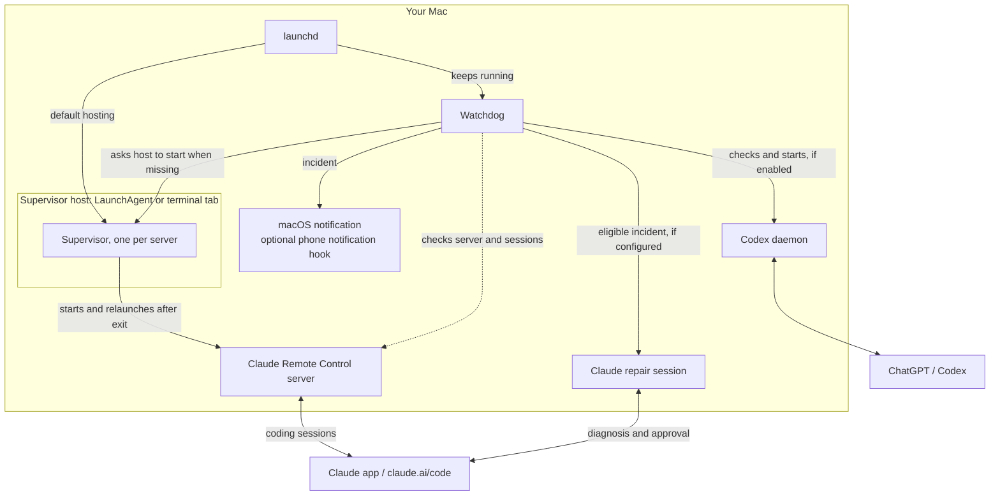

# remote-agents

[](https://github.com/iLubenets/remote-agents/actions/workflows/ci.yml)

**A macOS supervisor for Claude Code Remote Control.**

`claude remote-control` lets you use your Mac's coding sessions from a phone or a browser. But it
is a foreground program: when it exits (a crash, ten minutes offline, an expired login) nothing
starts it again, a careless restart can archive every open session, and nobody tells you.

remote-agents relaunches servers that exit, checks a planned restart for session-loss risks
before it stops anything, and alerts you when something needs attention. Codex remote control,
phone notifications and Claude repair sessions are optional extras.

## How it fits together



Exited servers are relaunched automatically. Running servers are not restarted on a schedule; use
`remote-agents restart NAME` for a guarded restart.

## Requirements

- macOS. Written in zsh using macOS system utilities; nothing to install besides Claude Code.
- Claude Code signed in with a claude.ai account (`claude auth login`). Remote Control does not
  work with an API key.
- Each folder you want to serve, trusted once: run `claude` there and accept, then run
  `claude remote-control` there once by hand and answer its first-run question.

## Quick start

```sh
git clone https://github.com/iLubenets/remote-agents ~/remote-agents
cd ~/remote-agents && ./install.sh      # links the command, creates the config
$EDITOR ~/.config/remote-agents/config  # see below
remote-agents install                   # loads the LaunchAgents
remote-agents doctor                    # says what is missing
```

The config needs one section per folder. The name is what the Claude app shows:

```ini
[server projects]
dir = ~/projects
flags = --permission-mode default
```

That is a working setup. Every other option is explained in
[config/remote-agents.conf.example](config/remote-agents.conf.example).

## Optional

| | How to turn it on |
|---|---|
| **Phone alerts** | `notify_command` under `[repair]`: any command, it gets the message as its last argument. [examples/notify-telegram](examples/notify-telegram) sends it to a Telegram chat. Without it an incident is only a notification on the Mac. |
| **Repair session** | `agent = claude` and a `dir` under `[repair]`: an empty folder of its own, trusted by Claude Code. For most incidents a Claude Code session on a cheap model then appears in your Claude app, diagnoses with read-only commands and asks you before it changes anything. |
| **Codex** | `enabled = yes` under `[codex]`, with the `codex` CLI signed in and paired once (`codex remote-control pair`). The daemon is checked every ten minutes and started when it is down. |
| **Terminal tabs instead of LaunchAgents** | `start_command`: the sessions then inherit the terminal's macOS permissions. |

## Commands

| Command | Purpose |
|---|---|
| `remote-agents status` | Every server, Codex, open incidents. `--watch` for a live view, `--json` for scripts. |
| `remote-agents doctor` | Checks the setup and says what is wrong. |
| `remote-agents restart NAME` | Guarded restart: refuses when the stop would lose sessions or cut a running turn, and verifies the environment afterwards. |
| `remote-agents stop NAME` / `start NAME` | Keeps a server stopped / lets it run again. |
| `remote-agents sessions` | Sessions per server, and which ones are detached. |
| `remote-agents reattach SESSION_ID --dir FOLDER` | Brings a detached session back. |
| `remote-agents incidents` / `logs` | What is open, and what happened. |

## Limitations

- A guarded restart checks the known ways to lose sessions; it is not a guarantee. The turn that
  is running during a restart is cut, and the session continues on your next message.
- After a restart a session that ran in `bypassPermissions` continues in your default permission
  mode: Claude Code does not restore that mode when it resumes a session.
- It does not update Claude Code or Codex, keep the Mac awake, or log it in after a reboot.
- When a server loses its environment anyway, it tells you and gives you the command. It does not
  rewrite Claude Code's files on its own.
- Unofficial. It relies on how Claude Code 2.1.325 and Codex CLI 0.169.0 behave; a release can
  change that.

## More

- [How it works](docs/how-it-works.md): the pieces, why a restart can lose sessions, what happens
  in each failure.
- [How it was tested](docs/testing.md): `zsh tests/run`, and the fault tests against real servers.
- [Repair runbook](docs/repair-runbook.md): what each incident means.

MIT license.
